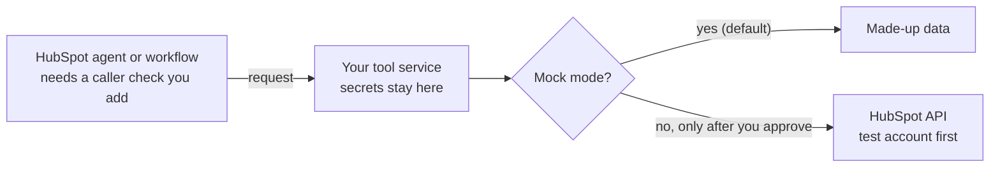

# HubSpot Agent Tools AI Starter

Learn to build an "agent tool": a small service that a HubSpot AI agent or
workflow can call to get useful information. You start with made-up data on
your own computer, with an AI assistant that follows written safety rules.

> [!WARNING]
> **This is a learning starter, not finished software.** It is not
> security-audited, not made or endorsed by HubSpot, and has no warranty or
> support promise. Practice with made-up data or a free HubSpot developer test
> account. You are responsible for what you build. See the [disclaimer](#disclaimer).

## What You Get

- A small working example that answers "give me a brief on this contact" from
  made-up data.
- Rules for your AI assistant ([AGENTS.md](AGENTS.md)): what it must never do, and
  when it must ask you first.
- A path from practice, to a test account, to a checklist before anything real.

This is what the example receives and returns. The data is made up, and nothing
here is installed in HubSpot.

```text
Question sent to the tool:   contactId "sample-1", briefType "sales"

Answer from the tool:
  contactName:          Sample Contact
  brief:                Sample Contact at Example Company is currently marked
                        as lead. Recent signal: Downloaded a pricing guide and
                        opened a follow-up email.
  recommendedNextStep:  Send a short personalized follow-up and ask one
                        discovery question.
  confidence:           sample
```

## Pick Your Path

| You are | Start here | You will have |
| --- | --- | --- |
| New to coding | [Step-by-step walkthrough](docs/start-here.md) | The sample running on your computer and a plan for your own tool |
| Building with an AI assistant | [The first prompt to paste](START_WITH_AI.md) | An assistant that explains each step and asks before risky ones |
| A developer | [Architecture](docs/developer-architecture.md), [data contract](docs/contracts/agent-tool-contract.md), [example](examples/simple-contact-brief-agent-tool/README.md) | The code map, request and response shapes, and tests |

A word you do not know? See the [glossary](docs/glossary.md).

## Try It

You need [Node.js](https://nodejs.org/en/download) 22 or newer and a terminal.
You do **not** need a HubSpot account, a password or key, or any package install.

1. On GitHub choose **Code > Download ZIP**, extract it, and open a terminal in
   the folder that contains `README.md`.
2. Run these two commands (in Windows PowerShell type `npm.cmd` instead of `npm`):

   ```bash
   npm run doctor
   npm run smoke:example
   ```

3. You are done when the last line says `agent smoke example passed.`

**What just happened:** a small program on your computer answered with a made-up
contact brief and stopped itself. Nothing was sent to HubSpot and no tool was
installed. If a command fails, stop and read [troubleshooting](docs/troubleshooting.md).
Never switch off a check or type in real credentials to make it pass.

## What To Do Next

1. **Change one small thing:** the [worked exercise](docs/worked-example.md).
2. **Plan your own tool:** the [blueprint](docs/agent-tool-blueprint.md) and the
   [idea recipes](recipes/README.md).
3. **Understand accounts and sign-in choices:** the
   [connection guide](docs/connect-to-hubspot.md). Your assistant must ask you
   before it connects anything.
4. **Read one test contact from a free HubSpot developer test account:** the
   [first test with HubSpot](docs/first-live-test.md) checklist.
5. **Before real customers or real data:** the
   [live-use checklist](docs/REAL_TOOL_CHECKLIST.md). That is a separate decision.

## How This Fits With HubSpot's Own Tools

HubSpot's official tools create and upload real projects: see the
[Build with AI quickstart](https://developers.hubspot.com/docs/build-with-ai/quickstart),
the guide to [creating an agent tool](https://developers.hubspot.com/docs/apps/developer-platform/add-features/agent-tools/create-an-agent-tool)
and the [official project templates](https://github.com/HubSpot/hubspot-project-components).
This starter covers what comes before and around them: practice with made-up
data, rules for your AI assistant, and a checklist before going live. It does
not replace the official tools or documentation.



The example's tool definition files are illustrations to read. They are not a
complete project you can upload.

## Safety Rules In Short

1. Keep passwords, keys and customer data out of AI chats, GitHub, screenshots
   and logs. Credentials belong on the server side, never in browser or card code.
2. Start with made-up data. Approve the exact account, access and action before
   anything touches a real HubSpot account.

More: [security in plain English](docs/security-for-non-developers.md) and
[the approval steps](docs/non-developer-safety-gates.md).

## For Developers

Run `npm run check:ai`, `npm run check`, `npm test` and `npm run smoke:example`;
no packages are needed. [docs/EVIDENCE.md](docs/EVIDENCE.md) records what was and was not
tested. Reference: [compatibility](docs/COMPATIBILITY.md),
[authentication](docs/auth-options.md), [hosting](docs/hosting-options.md),
[which starter you need](docs/choose-your-path.md), [migration notes](docs/MIGRATION.md)
and [upgrade notes](docs/UPGRADE_NOTES.md).

## Disclaimer

- **No warranty.** Provided "as is" under the [MIT License](LICENSE), which
  disclaims warranties and limits the authors' liability. Keep the copyright
  and license notice when you reuse the code.
- **A starter, not a product.** The examples are not production-ready, not
  security-audited, and not verified in a live HubSpot account. A passing test
  here does not prove that what you build is secure.
- **You are responsible for what you build:** testing, security, privacy, legal
  compliance, costs and your customers' data. See
  [implementation responsibility](docs/implementation-responsibility.md).
- **Independent project.** Not affiliated with, endorsed by or supported by
  HubSpot. HubSpot is a trademark of HubSpot, Inc.
- **Not professional advice.** Nothing here is legal, security or compliance
  advice. HubSpot's platform changes, so check the current official documentation.

Help is best-effort with no response-time promise: see [support](docs/SUPPORT.md).
Report security problems privately through [SECURITY.md](SECURITY.md).
